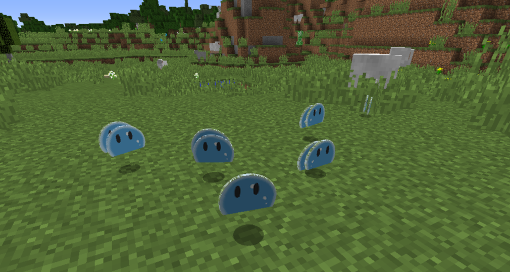
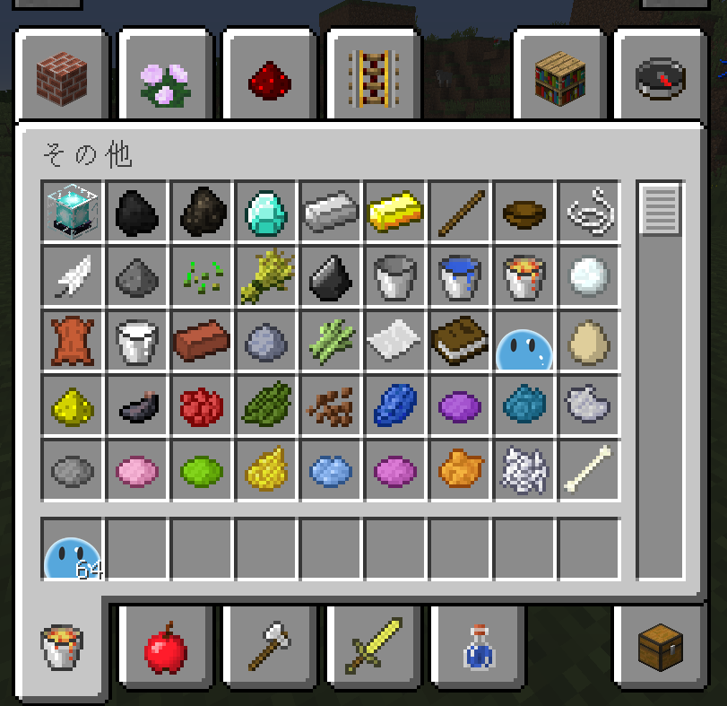

# Nyaimu Slimeball Texture（ニャイム スライムボール）

日本語 | [English](README.en.md)

バニラの「スライムボール」アイテムのテクスチャを、ペットスライム「ニャイム」に差し替えるリソースパックです。変わるのはスライムボールだけで、ほかはバニラのままです。

## ⬇ ダウンロード

- **[CurseForge](https://www.curseforge.com/minecraft/texture-packs/nyaimu-slimeball-texture)**

対応: **Minecraft Java Edition 1.12.2 〜 26.3**（動作確認: 1.12.2 / 1.13 / 26.3）。1.13 以降では「古いバージョン向け」と表示されますが、そのまま有効にして使えます。

## 導入方法

1. CurseForge から zip をダウンロードします（解凍しないでください）。
2. `.minecraft/resourcepacks` に入れます。
3. ゲーム内の「オプション > リソースパック」で有効にします。

補足: 独自のスライムボールテクスチャを使っている Mod のアイテムは変わりません。

## テクスチャ

| バージョン | パス |
|---|---|
| 1.12.2 以前 | `assets/minecraft/textures/items/slimeball.png` |
| 1.13 以降 | `assets/minecraft/textures/item/slime_ball.png` |

どちらも 64x64 の同じ画像です。

## 最近の更新

### 1.1.0

- 1.13 以降に対応（1 つの zip で 1.12.2 〜 26.3 まで使えます）
- リポジトリ名を `nyaimu-resourcepack` に変更

### 1.0.0

- 初回リリース（1.12.2 対応）

## ニャイムについて

ペットスライム「ニャイム」は Booth で販売しています。
Buy Me! https://booth.pm/ja/items/5036167

## ライセンス

[CC0 1.0](LICENSE)。

- **Modpack への同梱・改変・再配布は自由**です。許可や連絡は不要ですが、[issue](https://github.com/zeusisgood/nyaimu-resourcepack/issues) で教えてもらえると励みになります。
- 紹介や共有の際は、[CurseForge のページ](https://www.curseforge.com/minecraft/texture-packs/nyaimu-slimeball-texture)へのリンクで案内していただけると助かります。
